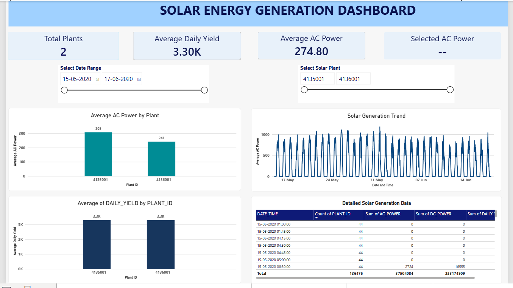
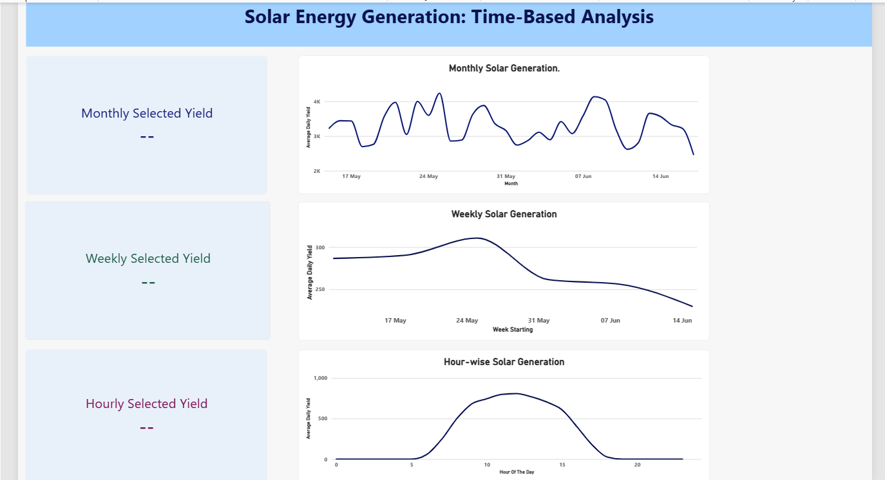
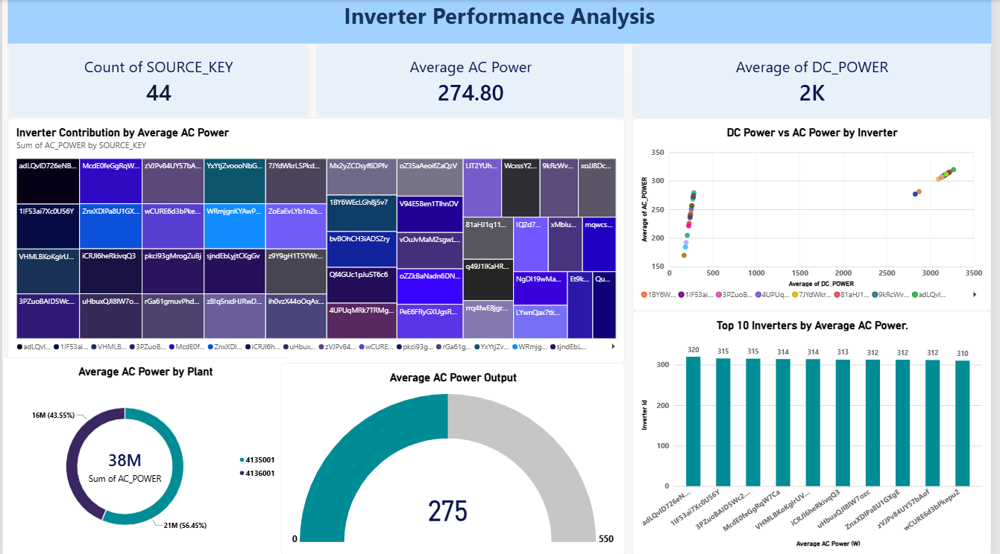
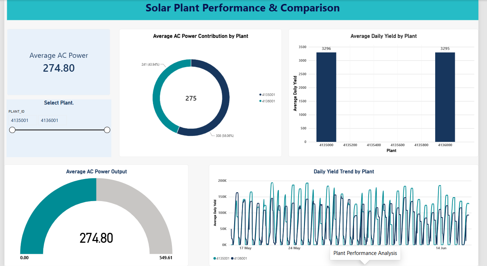
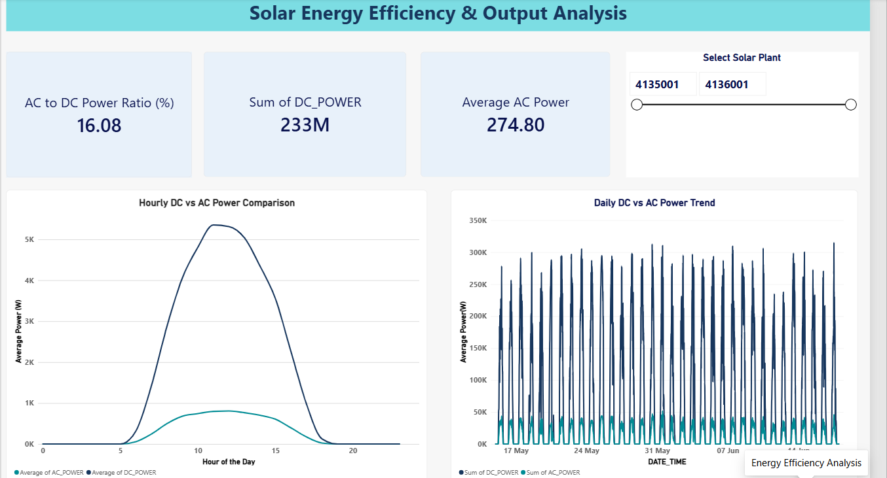
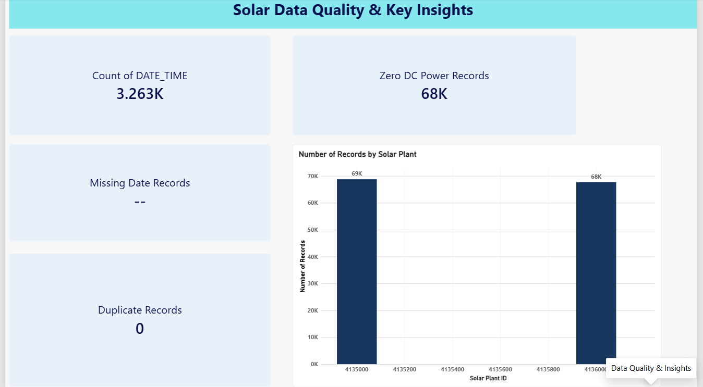

# Solar Energy Generation Analysis using Power BI

## Project Overview
This project focuses on analyzing solar energy generation data using Microsoft Power BI. It provides interactive dashboards to understand solar plant performance, inverter output, energy generation trends, and data quality.

The dashboard helps users explore solar energy performance through visual reports, KPIs, charts, and filters.

## Project Objectives
- Analyze solar energy generation across different plants.
- Compare weekly and monthly energy generation trends.
- Monitor inverter performance.
- Compare the performance of different solar plants.
- Analyze DC and AC power output.
- Identify missing, duplicate, and zero-power records.

## Dataset
The project uses solar power generation data containing information about two solar plants.

**Dataset columns:**
- DATE_TIME
- PLANT_ID
- SOURCE_KEY
- DC_POWER
- AC_POWER
- DAILY_YIELD
- TOTAL_YIELD

## Tools and Technologies
- Microsoft Power BI
- Power Query
- DAX (Data Analysis Expressions)
- R Programming
- CSV Dataset

## Dashboard Pages

### 1. Solar Energy Generation Overview
Provides an overview of solar energy generation using KPI cards, charts, and interactive filters.



### 2. Weekly and Monthly Analysis
Analyzes solar energy generation trends across different weeks and months.



### 3. Inverter Performance Analysis
Compares inverter performance and power generation to identify performance differences.



### 4. Plant Performance Analysis
Compares the performance of Plant 1 and Plant 2 using charts and KPIs.



### 5. Solar Energy Efficiency and Output Analysis
Examines AC and DC power output and their relationship to understand power conversion patterns.



### 6. Data Quality and Insights
Highlights data quality indicators, including missing date records, duplicate records, and zero DC power records.



## Key Features
- Interactive Power BI dashboards.
- Plant-wise performance comparison.
- Weekly and monthly trend analysis.
- Inverter-level performance analysis.
- AC and DC power comparison.
- Data quality monitoring.
- Interactive slicers and KPI cards.

## Project Structure
```text
solar-energy-generation-power-bi/
│
├── Screenshots/
│   ├── Overview.png
│   ├── Weekly_Monthly_Analysis.png
│   ├── Inverter_Analysis.png
│   ├── Plant_Analysis.png
│   ├── Efficiency_Analysis.png
│   └── Data_Quality.png
│
├── solar plant data.Report/
├── solar plant data.SemanticModel/
├── solar plant data.pbip
└── README.md
```

## Conclusion
This project demonstrates how Power BI can be used to analyze solar energy generation data and convert raw data into meaningful visual insights. It helps understand plant performance, inverter output, energy trends, and data quality.

## Author
**Sanchita Prajapat**

B.Tech – Computer Science and Engineering (Data Science)
